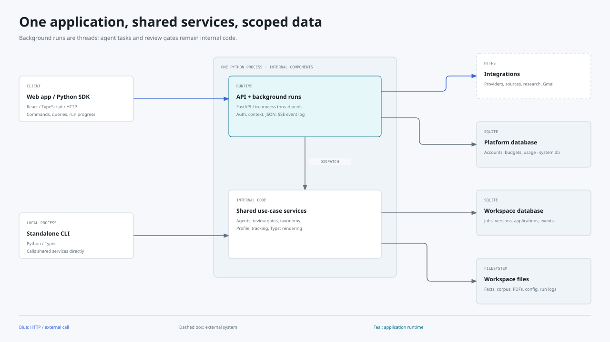
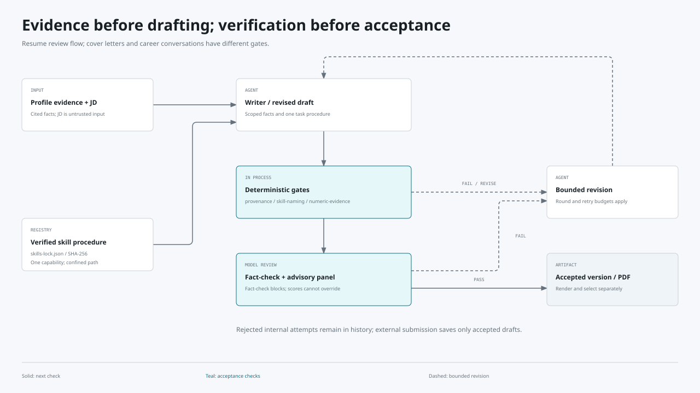

# Résumé Tailor Harness architecture blueprint

Reviewed 2026-10-25 against `9fa44306ca47246824e4c6afdfcbeab63b454fb3`.
This describes implemented code. Deployment configuration is evidence of a
supported topology, not proof of a running production instance.

## System shape

The project is a Python modular monolith with a React browser application,
a standalone CLI, and an independently installable Python SDK. FastAPI exposes
workspace operations; the CLI calls the same use-case services directly. Agents,
review gates, background workers, rendering, and database access execute inside
the Python application. They are not microservices. The SDK is an HTTP client;
an external agent's browser runs outside this application.

[Chinese diagram](docs/diagrams/system-architecture.zh-CN.html) ·
[System context](docs/diagrams/system-context.html) ·
[Diagram scope and source map](docs/diagrams/README.md)

The evidence profile is the boundary for generated claims. Job descriptions,
web pages, and model results are input data. Services decide when to persist
results, and deterministic checks constrain what agents can claim or change.
See [CLAUDE.md](CLAUDE.md) for the mandatory invariants.

## Components and dependency direction

Paths in this table are relative to `src/resume_tailor_harness/` unless stated.

| Component | Responsibility and interactions | Extension seam |
| --- | --- | --- |
| `api/`, `cli.py` | Validate transport input, select workspace, invoke services | Add a router/DTO or CLI command over an existing use case |
| `services/` | Coordinate persistence, runs, approval, and subsystem workflows | Keep shared behavior here so API and CLI do not diverge |
| `discovery/` | Acquire postings, resolve sources, filter, score, and upgrade canonical records | Connector dispatch in `discovery/connectors/companies.py`; retain per-source failure isolation |
| `profile/` | Register sources, extract literal/project/synthesis evidence, build facts and skill matrix | Per-mode producers in `profile/fragments.py`; project-only schema in `project_extractor.py` |
| `tailor/`, `cover_letter/`, `render/` | Draft, revise, validate, review, and render documents | Add a bounded review dimension or template without bypassing verdict/gate logic |
| `career_skills/`, `prompts/` | Resolve verified procedures and compose scoped task instructions | Register capabilities in root `skills-lock.json`; preserve family and use-stage checks |
| `taxonomy/` | Canonical aliases, domains, durable corrections, retirement, retrieval, and classification | Read `EffectiveTaxonomy`; write through `TaxonomyCustody` |
| `sessions/`, `career_lab/`, `interview/` | Store conversations, execute typed turns, and expose recoverable streams | Reuse session custody; keep task-specific context in adapters |
| `tracking/` | Jobs, versions, applications, event vocabulary, queries, timeline, and analytics | Share status rules and timeline projection rather than inventing parallel state |
| `tenancy/`, `security/`, `llm_runner.py` | Workspace context, credentials, spend, guarded fetches, model calls | Central seams for new integrations and provider routes |
| `web/src/` | Routed views, editors, boards, query cache, streamed runs, and localized display | Feature modules, shared UI components, typed API contracts |
| `sdk/python/` | Authenticated transport, run polling, external authoring, application preparation | Typed client methods and agent skills; no browser engine bundled |

The usual direction is **interface → service → subsystem → persistence/provider**.
Subsystems also call shared utilities and models. This is an organizational
boundary rather than a compiler-enforced clean-architecture layer graph; it does
not establish that the entire import graph is acyclic. One explicit separation
is `taxonomy/snapshot.py::OverrideView`, a protocol that consumes profile
overrides without importing the profile package.

FastAPI dependencies in `api/deps.py` supply sessions, paths, and configuration.
Agent bundles in `services/agents.py` inject runners; tests substitute fakes.
Request-local tenancy travels through a `ContextVar` and is propagated into
background runs, as documented in [ADR-0003](docs/adr/0003-contextvar-tenancy-propagation.md).

## Agent execution and review

`career_skills/models.py::AgentFamily` defines job analysis, resume authoring,
resume review, cover letter, interview, Career Lab, internal profile, and
sponsorship research. The pinned manifest currently contains procedures for
seven of those families; enum membership alone does not establish an installed
procedure. Scout, classification, and research helpers also have their own
structured agents. This is task dispatch, not an autonomous agent hierarchy.

1. A deterministic service chooses the task, scoped evidence, and model tier.
2. Skilled calls resolve one procedure through `CareerSkillRegistry`. Paths must
   remain under the configured root and file bytes must match the manifest hash.
   Missing or substituted procedures disable the capability.
3. `llm_runner.py` builds the selected provider adapter and mediates model calls.
   `concurrency.py::gather_isolated` supports bounded, ordered fan-out; LLM permits
   are acquired at leaf calls rather than around a nested batch.
4. Resume drafts undergo provenance, skill-naming, and numeric-evidence checks
   before the paid reviewer panel. Fact-check is a blocking, unscored review;
   advisory scores cannot compensate for a failed gate. Gate reviewers see cited
   facts; advisory reviewers receive less context (`tailor/panel.py`).
5. `tailor/verdict.py::aggregate` constructs the verdict. The workflow revises
   within configured round/retry bounds and retains attempt history. Internal
   attempts can be saved even when rejected; acceptance is a separate property.
6. Cover letters use deterministic provenance checks rather than the resume
   reviewer panel. Career Lab remains draft-only. Coach drafts require user
   approval before becoming saved evidence.

External authoring uses `services/external_tailoring.py`: an authoring context
revision binds facts and JD, deterministic validation is preflight only, and
submission runs server-owned review. The revision is rechecked before saving;
external clients cannot supply their own trusted reviewer verdict.

## Data architecture and custody

| Data | Owner and representation | Important rule |
| --- | --- | --- |
| Job and application state | Workspace SQLite; `tracking/tables.py` | Canonical-source upgrades retain the job ID and user progress |
| Resume/letter attempts and application events | Workspace SQLite | Redo appends attempts; timeline projection powers grid, CSV, and analytics |
| Facts, corpus, matrix, taxonomy sidecars | Workspace files under `data/profile/` | Evidence is source-derived; generated taxonomy and user corrections stay distinct |
| Sessions and run events | Workspace session/run files | One conversational turn per run; durable events support reconnects |
| PDFs, configuration, credentials | Workspace files via tenancy paths | Downloads resolve tenant-confined artifacts, not arbitrary server paths |
| Accounts, quotas, usage, credits | Platform `system.db` | Platform spend governance is separate from workspace job state |

`db.py` owns engine construction. File-backed workspaces use SQLite settings
appropriate to that store; shared in-memory tests use a named shared-cache
database with `QueuePool` and cross-thread connections. This avoids giving each
worker an unrelated in-memory database. It does not remove SQLite's writer
contention. Persistence uses SQLModel sessions and direct queries; the codebase
does not impose one generic repository abstraction on all domains.

The profile corpus and fragment cache avoid repeating unchanged extraction.
`profile/github_harvest.py` discovers root dossiers with matching repository
identity and lets them supersede shallower harvested docs. Project extraction
cannot emit employment or education. Image descriptions are not factual
verification evidence; synthesis uses extractable source text.

Taxonomy reads combine generated mappings, corrections, state, and overrides in
`taxonomy/snapshot.py`. Semantic hashes trace that composition. Mutations use
file locking, strict sidecar reads, and revision checks in `taxonomy/custody.py`;
corrupt mutation inputs must not silently become an empty correction ledger.

## Recent capability flows

### Skill recovery and reversible cleanup

`services/match_gap.py` coordinates canonicalization, domain classification,
recovery, and persistence. Defaults in `config.py` admit 50 model calls and
1,000,000 UTF-8 task-prompt bytes across a regroup, up to three recovery rounds,
and three durable automatic attempts per item. These limits exclude output,
system/schema overhead, embeddings, and provider retries. Budget deferral is
not a model judgment. Provider failure does not justify an invented placement.
Successful siblings can commit even when other batches fail.

General placements remain visibly provisional and do not imply adjacency.
`taxonomy/non_skills.py` proposes degree, tenure, eligibility, or travel
requirements for review. Explicit discard records a canonical retirement;
`EffectiveTaxonomy` excludes it and its aliases from consumers. Restore makes
the key eligible for regrouping. Neither action rewrites the source evidence.
Tests include `tests/test_taxonomy_non_skills.py`, `tests/test_taxonomy_custody.py`,
`tests/test_effective_taxonomy_seam.py`, and `tests/test_services_match_gap.py`.

### External application preparation

`services/application_prompt.py` formats saved facts, applicant answers, and
search preferences without a model call. Professional screening fields include
industry experience, technical direction, coding preferences, and office
attendance. Blank is unknown, never a default No.

`services/agent_applications.py` excludes archived or previously submitted jobs,
returns scoped questions and checked attachment IDs, and checks profile/question
revisions on writes. Reading context creates no application record. Instructions
tell the external browser agent to record only confirmed answers and obtain
confirmation before final submission. This is an agent handoff instruction;
the server does not control the external browser or prove its compliance.
See `tests/api/test_agent_applications.py` and `tests/test_application_prompt.py`.

## Cross-cutting boundaries

- Hosted authentication selects a workspace through `tenancy/`; personal access
  tokens grant access to their owning workspace. Local mode uses a default
  workspace. Registration and shared-key eligibility are separate decisions.
- `tenancy/spend.py` gates shared model spend and records settlement. Rate
  history in `tenancy/costs.py` is effective-dated; changing the catalog must not
  retroactively reprice existing usage. Admission budgets are not invoice totals.
- User-influenced public fetches use `security/outbound.py`, including redirect
  and address validation. Artifact path checks and bounded archive extraction
  are separate controls; see [ADR-0008](docs/adr/0008-egress-gateway-tenant-storage-canonical-origin.md).
- Agent tools are read-only within the loop. Deterministic writes follow the
  loop through approved service actions; external browser activity is outside
  that boundary. See [ADR-0005](docs/adr/0005-read-only-agent-tools-deterministic-writes.md).
- `llm_runner.py` centralizes structured outputs, provider compatibility, model
  routing, retry configuration, and usage observation. Acquisition additionally
  uses source cooldowns and per-source failure isolation. These mechanisms do
  not establish a universal circuit breaker for every integration.
- API validation uses typed DTOs and structured errors. Background progress and
  terminal outcomes are retained in run history; cancellation is cooperative.
  Operational event logs and usage records do not constitute an uptime result.
- Configuration is split between environment/secrets and workspace YAML. The
  settings bundle uses `settings_sections.py` to enumerate editable/resettable
  sections. Never cache tenant-resolved settings across requests.

## Browser and communication patterns

The browser uses React feature composition, React Router, TanStack Query for
server state, and Zustand for local stores (`web/package.json`, `web/src/`).
HTTP JSON carries commands and queries; SSE carries run events. Session/run
hooks hydrate persisted history and reconnect to active work. These events are
not a distributed message bus, and background runs are not external queue
workers. The SDK polls the same server-owned runs.

`api/runs/agui.py` projects the existing durable event log into AG-UI events
while retaining ownership checks and replay offsets. Native SSE remains
available. `resume.settled` is nonterminal. Scout cards reference persisted
proposal IDs; Career Lab revisions target a specific draft turn and share
conversation context across skills. Model output does not execute UI code.
See [the chat workspace reference](docs/ag-ui-chat-workspace.md).

`services/email_notifications.py` verifies a notification destination and sends
selected digest topics on a daily, weekly, or 30-day interval. Saved account
language controls localized mail through `mail/localization.py`; inbox sync and
application email drafts remain separate flows. Hosted payments in
`tenancy/payments.py` validate signed Stripe webhooks before updating existing
credit/subscription ledgers. Standard Checkout and optional Managed Payments
are deployment-configured paths, not model tools.

API schemas produce the OpenAPI and TypeScript contract artifacts under
`contracts/`; the SDK is maintained alongside those resources. Do not assume
all internal Python models are wire-compatible with camelCase API DTOs.
`web/scripts/i18n-catalog.mjs` verifies static/runtime copy and backend progress
labels; `web/src/i18n/dynamic-labels.ts` covers dynamic display values. Localize
display text while preserving protocol keys and interpolation variables.

## Deployment, tests, and governance

`Dockerfile` builds the browser assets, installs frozen Python dependencies,
and runs the API with the SPA assets in one image. The browser remains a
separate execution environment. Compose binds local access to loopback and
persists data in a volume; `compose.h1b.yaml` adds an optional MCP companion.
Railway deployment configuration follows a single service owning the whole
data root, per [ADR-0002](docs/adr/0002-single-service-sqlite-volume-whole-root-custody.md).
Scaling to independent writers would require revisiting these custody assumptions.

Backend pytest tests inject fake agents, browser behavior, and connector
responses. Frontend Vitest tests cover feature behavior; Playwright checks
exercise browser interactions and accessibility. Evals have their own fixtures
and reporting under `evals/`. Offline checks demonstrate mechanics, not live
provider behavior, current employer availability, or production acceptance.

Quality checks include Ruff, Pyright, frontend lint/build, offline tests, locked
dependency audits, and catalog verification. Required CI runs for `main`;
do not infer a `dev` push has run that complete suite. All normal work starts
from `dev`. Only `dev` promotion PRs and documented `hotfix/*` exceptions may
target protected `main`. See `.github/workflows/` and the branching reference.

## Architectural decisions and extension guide

Documented decisions, rather than inferred historical motives:

| Decision | Consequence | Reference |
| --- | --- | --- |
| One service owns the whole data root | Portable custody; shared-writer deployment needs redesign | ADR-0002 |
| ContextVar tenancy | API, CLI, and worker threads share one context mechanism | ADR-0003 |
| Read-only tools and deterministic writes | Agent loops cannot directly mutate saved state | ADR-0005 |
| Turn-per-run sessions | Recoverable conversations reuse durable run machinery | ADR-0006 |
| Curated single-skill agents | Hash/version traceability; broken skills disable capabilities | ADR-0011 |
| Forward application progression | Rejections/closure are terminal exits; redo does not regress status | ADR-0012, ADR-0013 |

Full records, alternatives, and rationale are in [the ADR index](docs/adr/README.md).

For a new feature, start with the owning subsystem and its nested `CLAUDE.md`.
Add typed models, implement a shared service, expose API/CLI adapters, update
contracts, then build the browser feature and translations. Keep deterministic
checks below transport entry points so alternate clients receive the same rules.
Existing templates worth following are `api/routers/agent_applications.py` for
thin routes, `services/agent_applications.py` for revision conflicts,
`taxonomy/snapshot.py::OverrideView` for dependency inversion, and
`services/agents.py` for runner injection. Reuse these patterns rather than
introducing a generic base class without a concrete need.

Add integrations through the guarded transport and model seams. Preserve source
priority, workspace paths, spend gating, cancellation, and partial-failure
semantics. Add regression tests at the relevant boundary, update generated
contracts/catalogs when their inputs change, and document new architectural
decisions in an ADR. Common mistakes include mistaking provisional classification
for evidence, treating preflight as fact approval, acquiring an LLM permit around
nested fan-out, or presenting fixture checks as live validation.

Refresh this blueprint and both READMEs whenever runtime boundaries, persisted
state, agent permissions, or acceptance rules change. Update diagram HTML,
semantic models, and SVG exports together; frozen dossier metrics should retain
their source revision until deliberately remeasured.
