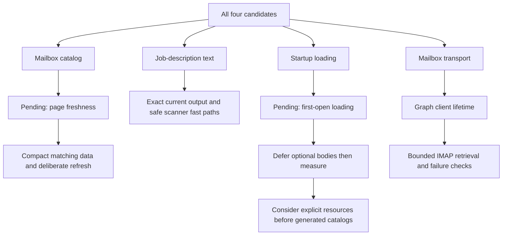

# Architecture and performance exploration

Status: all four candidates explored and implemented on the isolated branch.
The user approved both product decisions below. Local validation and measured
results are recorded in the delivery section.

Source: local `dev` at `edbe85b3faf3a23055a4b85e43e4c0c2d8a1eb31`.
Design work is isolated on `refactor/architecture-performance`.
The original detached checkout and its localization edits are untouched.

## Approved decisions

1. **First-open loading: yes.** Allow a brief localized loading state when a
   less-used dialog first opens, with cancellation,
   recoverable loading errors, stable focus, and retained input after loading.
2. **Changes during mailbox sync: yes.** Apply saved Job/Application changes to the
   next page of messages, using a narrow bulk read at
   each page boundary. The alternative is a consistent starting snapshot,
   which can produce proposals for jobs archived during the pass. Proposal
   acceptance must revalidate current state in either case.

The selected scope is already settled: explore all four. Existing tenancy,
read-only mail access, review, egress, text-output, and localization requirements
are implementation constraints, not questions to reopen.



## 1. Mailbox catalog ownership

### Finding and constraints

`gmail/processing.py` retains Job/Application ORM objects and matching indexes
across commits. Gmail staging commits before processing a discovered page;
`services/mailboxes.py` commits before its first transport page. The sync locks
serialize syncs but do not block ordinary Job/Application edits.

Measured SELECTs through the actual processor:

| Fresh messages | Before commit | After commit |
| ---: | ---: | ---: |
| 1 | 3 | 5 |
| 10 | 3 | 23 |
| 100 | 3 | 203 |

The 200 added reads in the final row are 100 Job and 100 Application refreshes.
This is a comparison of two existing lifecycle states, not an implemented gain.

A second-session probe exposed inconsistent freshness: archiving a job or
adding a competing same-company application after processor construction still
allowed one pending proposal; changing the matched application's status to
`closed` correctly prevented a proposal. Frozen indexes and incidentally
refreshed ORM attributes do not form a coherent snapshot.

### Selected module shape

Keep the existing mail-analysis module and normalized-message interface.
Its implementation owns narrow, non-expiring matching data, catalog revision,
index reuse, and explicit freshness. Do not expose SQLAlchemy object lifetime
through the interface or disable expiration globally.

With page freshness selected, read current eligible applications and the Job
fields needed by matching once per page, in a transaction that can see committed
edits. Rebuild indexes only when their relevant revision changes. Include
status, submitted date, archive eligibility, and new/removed competing jobs in
the freshness design; refreshing only matched status is insufficient.

The projection needs application/job identities, company, title, URL, source
identity, submitted date, current status, and current active membership. It
does not need full descriptions, criteria JSON, rationale, notes, or artifact
pointers. A narrow joined read can supply the snapshot without live ORM rows.
Freshness means page-start visibility, not instantaneous reaction to an edit
made while that page is being classified. Classifier version and effective
AI-enabled mode remain pass-scoped; completed classification results remain
reusable independently of catalog changes.

Keep receipt/classification reuse, cross-account chronology, notification
supersession, and accepted/dismissed identities behind the existing processor
seam. Do not create a process-wide tenant catalog cache.

Catalog refresh and revision changes must not cause unbounded cached-message
reprocessing within a single pass. Existing run budgets remain in force;
deferred work must remain resumable and old receipt associations must not
silently transfer to another application.

The dependency is local-substitutable: test through the processing interface
with SQLite, including a second Session for concurrent edits. Production and
fake transport adapters already supply messages at a real seam.

### Tests and acceptance

- Preserve existing mailbox, incremental-sync, matching, proposal, receipt,
  recovery, chronology, tenancy, and acceptance tests.
- Add fresh-page query-count cases after a commit. Queries must not grow by
  one Job/Application SELECT per message; allow only fixed page reads and
  documented bounded query chunks.
- Add status, archive/restore, competing application, metadata edit, deletion,
  and new-application scenarios between pages.
- Verify classification reuse is independent of catalog rematching and that
  removed/archived targets cannot gain new proposals.
- Update the existing cached-page one-SELECT expectation deliberately if the
  selected freshness policy adds a bounded catalog read.
- Preserve atomic receipt/proposal/checkpoint commits, cancellation, retry,
  and current-state validation when accepting a proposal.

The deletion test favors deepening the processor: deleting it would distribute
decision rules across Gmail, Graph, and IMAP callers. Locality belongs inside
that module; leverage comes from all adapters sharing the same corrected
lifetime semantics. Compatible with ADR-0002, ADR-0003, and ADR-0012.

## 2. Job-description text ownership

### Finding and constraints

`tracking/queries.py` imports connector text machinery to clean full job detail
and to produce `clean_job_description_text(job.jd_text)[:400]` for Pipeline.
Five profiled later-page reads spent 3.030 of 3.320 seconds in cleanup; icon
scanning accounted for 2.659 seconds. Each page made nine SELECTs.

A fixed raw prefix cannot preserve the cleaned preview. A matching escaped-bold
closer may appear arbitrarily far later on the same line. Leading whitespace
or removable icons can also consume arbitrary input before producing content.
Cleanup is not currently idempotent: `\*\*_work_\*\*` becomes `_work_` on
its first cleanup and empty text on its second.

Whole-workspace restoration preserves legacy descriptions. CSV/JSON imports
allow large fields, and there is no universal normalized-storage invariant.
HTML conversion is also used by profile intake and email body processing, so
normalization-policy changes can affect more than board rendering.

### Recommended module shape

Move only pure description normalization and cleaned-preview behavior into a
small text module. Keep HTML parsing/conversion, JSON-LD, location formatting,
search configuration, and connector filtering in their existing adapter.
Retain a compatibility export where needed while callers move to the pure
module. The pure implementation needs no injected adapter.

First optimize absent-marker checks while retaining the established linear
scanner. Preserve escaped-icon-before-plain-icon ordering, the icon allowlist,
token delimiters, punctuation rules, Markdown, Unicode whitespace, and all
cleanup ordering. A preview interface should hide cleanup-plus-slice ordering
while initially preserving its exact output.

Do not add stored previews, a migration, an "already normalized" flag, or a
streaming parser in this first change. Those introduce invalidation and
compatibility work the measured bottleneck does not require.

### Evidence and acceptance

A temporary absent-marker-guard prototype matched current output on 2,011
curated/random cases. For fifty plain 6,095-character descriptions, nine-sample
medians were 109.563 ms current versus 17.381 ms prototype, an approximately
84% cleanup reduction. This is synthetic prototype evidence only; it is not a
production or endpoint speedup.

Preserve connector-text, tracking projection, public board, ingestion/dedup,
recipe parsing, and Pipeline payload tests. Add exact output cases for long
malformed tokens, distant escaped-bold closers, Unicode whitespace, and the
non-idempotent example. Preview results must equal full-clean-then-slice.

Re-run the same board benchmark at 2,000 and 10,000 jobs on pages 1 and last.
Record endpoint-level before/after measurements separately from microbenchmarks.
Keep SQL paging, full detail, <=400-character previews, and <150 KB Pipeline
payloads. Avoid flaky wall-clock assertions in the ordinary test suite.

The deletion test preserves shared normalization; deleting it would duplicate
rules. Depth comes from owning normalization and preview semantics, locality
from removing tracking's knowledge of connector internals, and leverage from
all existing text callers. Compatible with ADR-0007.

## 3. Startup loading ownership

### Finding and constraints

The build's static startup graph contains 333,385 gzip bytes in 29 assets,
before route-specific downloads. The documented target is 200,000 bytes; its
131.72 KB baseline is stale. The 76,213-byte i18n asset is part of that graph,
not a promised removable amount.

The eager path includes:

```text
router -> AppLayout -> RunActions -> AddUrlDialog -> ScrapeImport -> ScrapePreview
                     |              ManualJobDialog / ImportJobsDialog
                     -> NotificationsBell -> EmailDraftDialog
main -> i18n -> all explicit resources + all English automatic translations
```

AppLayout mounts separate desktop/mobile RunActions instances. Manual-job and
import state survives ordinary close/reopen today. Completion effects must
remain registered before run rehydration. Auth/public startup and authenticated
Dashboard startup have different download graphs and must be measured apart.

### Selected startup sequence

1. Keep small triggers and stable dialog/focus ownership eager. Defer optional
   dialog bodies until first activation; retain loaded state across closes.
   Put loading, cancellation, failure, retry, and focus restoration behind the
   feature's action interface. Preserve both responsive trigger paths.
2. Separately defer the authenticated shell for public routes, preserving auth,
   setup gates, and cold deep links. Do not claim this reduces authenticated
   Dashboard bytes without measuring that route.
3. Rebuild and attribute remaining eager imports. Where justified, let clearly
   owned explicit translation groups load with their feature module.
4. Consider partitioning generated automatic catalogs only if the remaining
   measured cost warrants the generator/transform change.

The current transform injects synchronous `i18n.t('auto.<hash>')` calls and lazy
getters for module-level labels. Merely making catalog imports asynchronous can
expose raw keys or English fallback in Chinese. Any later catalog partitioning
must define shared-string ownership and readiness for both navigation and
action adapters. Preserve the active language/form tree until replacement
resources are ready; do not remount forms by language.

### Tests and acceptance

- Retain manual-job payload/error/draft tests, import report tests, URL bounds,
  email drafting, language selection/persistence, automatic-transform
  reactivity, and localization coverage.
- Add delayed/rejected chunk, retry, Escape during loading, focus restoration,
  close/reopen input retention, and resize-with-open-dialog browser scenarios.
- Cover English and Chinese, cold deep links, public/authenticated entries,
  and 375/768/1440-pixel layouts.
- Verify optional code is absent before activation and reused afterward.
- Keep the 200 KB target. Measure the transitive initial graph and complete
  entry routes consistently; do not count only the entry filename, silently
  relax the target, or invent a saving from chunk size.
- Run catalog generation/check when ownership changes, TypeScript, focused web
  tests, production build, and relevant browser tests.
- Add a deterministic build guard. Browser LCP/INP/CLS and real-user telemetry
  are separate evidence; no real-user improvement is established yet.

Moving imports alone fails the deletion test: complexity merely moves. The
feature module earns depth by owning loading/readiness/errors/state behind a
small interface. That gives locality to one feature and leverage to both its
navigation and action adapters.

## 4. Mailbox read-pass ownership

### Finding and direction

Five Graph page reads construct five HTTP clients for five requests. A
100-message IMAP page issues one SEARCH plus 100 serial FETCH commands.
These counters use real reader code with offline adapters, not live providers.

Use a pass-scoped, account-scoped Graph client with explicit cleanup. Keep
allowlisted continuation URLs, current token handling, and request bounds
inside the Graph adapter. Do not introduce a global authenticated client.

Preserve `trust_env=False`, disabled redirects, current timeout and token
refresh behavior, and the 5 MiB streamed-response cap. Graph's requested
50-message page size is advisory; the byte cap is the enforced bound.
The same pass-owned client also covers expired-delta fallback.

Treat IMAP batching as a separate bounded change. Preserve read-only commands,
per-message byte limits, cancellation, UID ordering/validity, and page-level
checkpoint semantics. Determine aggregate response limits before selecting a
batch size; a simple count limit is insufficient when messages vary in size.
Partial or malformed batches must leave unfinished work retryable without
silently skipping UIDs.

IMAP already reuses a connection per account pass. Start with at most eight
explicit UIDs per command, retaining the 128 KiB per-literal cap and enforcing
an aggregate 1 MiB requested-literal budget plus bounded protocol overhead
while consuming the response, before unbounded buffering. Include UID in the
requested fields and map by returned UID, not response order. Missing selected
UIDs retain the current expunged-message behavior; duplicate or unsolicited
identities need a deliberate rejection rule. Check cancellation between
batches and during response handling. If safe bounded consumption cannot be
implemented with the current transport, retain serial reads rather than
quietly increasing memory or cancellation costs.

Preserve the recovery distinction: a transport failure leaves the page cursor
unchanged, whereas optional AI failure/budget exhaustion can save retryable
receipts and advance the transport cursor.

### Tests and acceptance

- Five Graph pages should use one account-scoped data client while still making
  the required page requests; close it on success, cancellation, and failure.
- Keep distinct accounts, credentials, and continuation validation isolated.
- For IMAP, count commands, verify the actual returned UID association, cap
  response work, and test partial/out-of-order/missing/oversized responses.
- Preserve existing retryable-cursor, folder, UIDVALIDITY, transport-policy,
  failed-read, and cancellation tests.
- Prove reduced operation counts with fake adapters before any provider claim.
  Live-provider compatibility and latency remain a separate validation level.

Graph and IMAP are true external dependencies: use mock adapters for tests.
Their real differences justify the seam, but not a new generic transport
framework. Keep protocol rules in each adapter; concentrate lifetime/work limits
inside the read-pass module. This gives locality and leverage without deleting
valuable provider-specific depth. Preserve ADR-0008.

## Delivery and evidence

Recommended focused sequence: mailbox catalog, pure text cleanup, deferred
frontend bodies, then Graph reuse and bounded IMAP retrieval. These can be
reviewed separately; fresh baselines precede each runtime change. Deeper locale
partitioning is conditional on the rebuilt graph, not a mandatory rewrite.

Implemented modules and boundaries:

- `gmail/catalog.py` owns immutable matching inputs, revision calculation, and
  index reuse. Each processing page refreshes scalar fields in one joined read.
  Archived/restored/deleted/new jobs and edited applications are visible on the
  next page; classification caching and proposal ownership remain unchanged.
- `job_description.py` owns pure cleanup and previews. The connector exports
  the existing function for compatibility. Fast delimiter guards avoid two
  Python scans on plain text; cleanup order and full-input preview semantics
  are preserved, including non-idempotent escaped markup.
- Deferred form bodies preserve their state outside the dialog portal. The
  authenticated shell loads only after the auth gate admits the workspace.
  English/Chinese loading and error controls are immediate. Failed browser
  module downloads offer an explicit reload, rather than an ineffective repeat
  import; this can discard other unsaved page input and is never automatic.
- A Graph sync owns one HTTP client across pages. IMAP batches at most eight
  requested UIDs, verifies returned identities, and restores requested order.
  Socket reads enforce 128 KiB per literal, eight literals / 1 MiB per command,
  and 64 KiB aggregate response metadata before allocating unbounded input.
  Cancellation and page cursor commit behavior remain intact.

Measured local improvements (synthetic fixtures; not production latency):

| Workload | Before | After |
| --- | ---: | ---: |
| 100 fresh mailbox messages after a commit | 203 SELECTs | 5 SELECTs |
| 100 IMAP messages | 100 FETCH commands | 13 FETCH commands |
| Five Graph pages | Five clients | One client |
| Initial transitive JS graph | 333,385 gzip bytes | 263,015 gzip bytes |
| Cold Dashboard JS graph | 355,006 gzip bytes | 354,573 gzip bytes |
| Cold Pipeline JS graph | 617,030 gzip bytes | 618,077 gzip bytes |
| Pipeline, 2,000 jobs, page 1 | 157.5 ms median | 74.1 ms median |
| Pipeline, 2,000 jobs, page 40 | 115.7 ms median | 32.9 ms median |
| Pipeline, 10,000 jobs, page 1 | 410.9 ms median | 325.7 ms median |
| Pipeline, 10,000 jobs, page 200 | 137.7 ms median | 64.9 ms median |

The board figures above are a final paired rerun of the unchanged baseline and
this branch, sequentially on the same machine with seven samples per case,
using `scripts/bench_board.py --rows 2000 10000 --repeat 7 --board pipeline
--page 1 40 200`. They supersede the noisier exploratory timings earlier in
this report. Serialized payload sizes are identical in every case. No raw-text
truncation or persistence migration was used to obtain the improvement.

The 200 KB initial-JavaScript target remains unmet. `web/performance-budget.md`
documents the gap; `perf:check` enforces regression ceilings for the full entry
and cold-route graphs. Locale partitioning remains a measured follow-up, not an
unverified rewrite. Pipeline's deferred editor dependencies remain significant.
Grouping only the actual initial imports avoids the compression overhead from
small shared chunks. Cold Dashboard size is effectively unchanged and Pipeline
is 0.2% larger; the 21% saving applies to the initial/public graph.

Validation includes the full Python and frontend suites, Pyright with warnings,
Ruff, ESLint, a production build, and browser checks for both locales at narrow
and desktop widths. Regression tests cover catalog edits between pages, cached
classification reuse, invalid/out-of-order IMAP batches, allocation bounds,
client closure on failures/cancellation, delayed dialogs, draft retention,
focus, resize, and module-download recovery. The full Python run also exposed
two omitted Microsoft OAuth configuration rows; the reference now includes them.
Live mailbox providers, deployment, and real-user performance were not exercised.

Final local validation after review fixes and rebasing onto `dev` at `ff91c619`:
4,974 Python tests passed, six skipped, plus 29 subtests;
1,007 frontend tests passed; 18 production-build browser tests passed. Pyright
reported zero errors or warnings; Ruff, ESLint, translation-catalog validation,
TypeScript, and the build/bundle ceilings passed. The Python suite emits 12
existing warnings. Evidence logs and paired benchmark outputs are retained in
`output/architecture-performance-20261030/` in the implementation worktree.

Review fixes add a bounded cached-decision revalidation pass before normal
chronological reconciliation. It preserves bound application identities,
completed classifications, and equal-timestamp ordering, and leaves explicit
cleared-card recovery subject to its original current-revision requirement.
The extra bulk read accounts for the five-query total above. IMAP metadata is
assembled across literal prefixes and trailers, then parsed case-insensitively
at the top level so FLAGS and quoted values cannot supply a false UID.
Regression tests cover both reported failures, cross-account chronology, and
revalidation across a 500-receipt batch boundary.

Baseline artifacts are in:
`C:\Users\24216\AppData\Local\Temp\resume-architecture-review-20261030-102022`.
Temporary query, transport, mid-pass, and text probes remain in `%TEMP%`.
The visual candidate report is
`C:\Users\24216\AppData\Local\Temp\architecture-review-20261030-1032.html`.

Documentation consulted for library-dependent constraints:

- [SQLAlchemy refresh and transaction visibility](https://docs.sqlalchemy.org/en/20/orm/session_state_management.html)
- [SQLAlchemy populate_existing](https://docs.sqlalchemy.org/en/20/orm/queryguide/api.html#populate-existing)
- [HTTPX client lifetime and pooling](https://www.python-httpx.org/advanced/clients/)

In particular, ORM refresh must not overwrite pending writes, and another
session's committed change is visible only when the transaction rules allow
it. These are reasons to make page freshness deliberate, not merely add a
refresh flag to an existing query.
